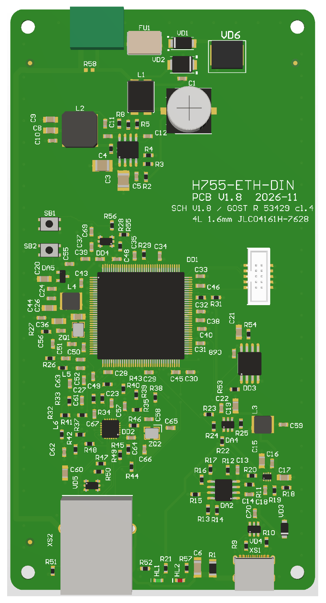
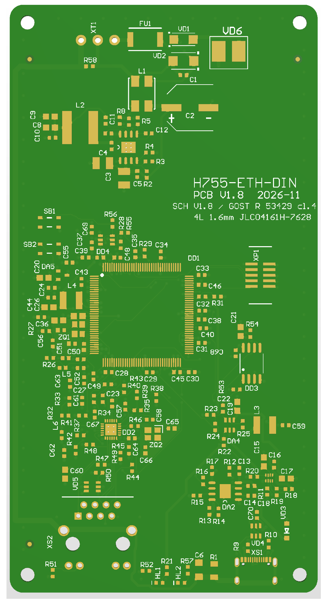
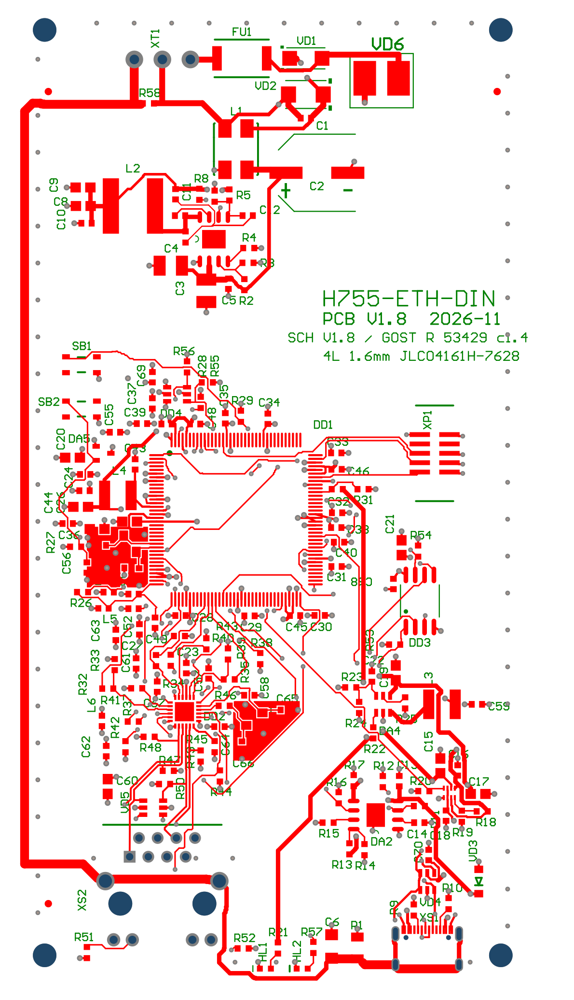

# H755-ETH-DIN V1.8: виды платы

Эти изображения взяты со страниц 1–3 предоставленного `H755-ETH-DIN-KD.pdf` (SHA-256 `d24d14076940a7dc5b18e5b6c9abca86c2d5cdb1ba98e24430dd3a9f91e6de97`). Страницы отрисованы в PNG и обрезаны по области платы. Электрическая схема и трассировка при этом не редактировались. PDF целиком в этот репозиторий не добавлен.

## С компонентами, 3D

## Без компонентов, 3D

## Печатная плата, 2D

На чертеже плата названа STM32H755 PROFINET IO Controller. Сейчас код в этом репозитории рассчитан на NUCLEO-H755ZI-Q и реализует Ethernet с lwIP и USB CDC, но не PROFINET. До запуска на H755-ETH-DIN нужно отдельно сверить распиновку, питание и тактирование, память, PHY, USB, запуск обоих ядер и отладочный интерфейс с её схемой. Рендеры не подтверждают изготовление, монтаж или работу платы.
